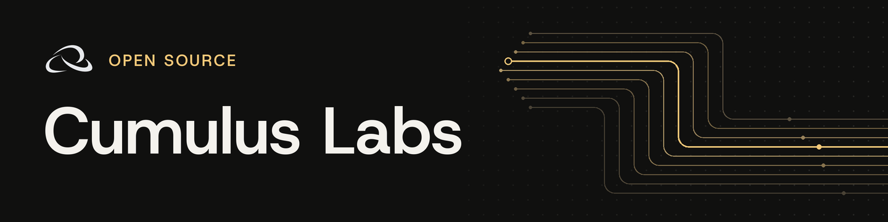

We build infrastructure for running AI in production: GPU orchestration, multimodal inference, and agent tooling.

[Website](https://www.cumuluslabs.io/) · [IonRouter](https://ionrouter.io/) · [Developer docs](https://docs.cumuluslabs.io/)

## Open source

This is our home on GitHub for public projects, forks, and upstream contributions. If you’re working from one of our forks, follow the original project’s guidelines and open issues or pull requests upstream.
